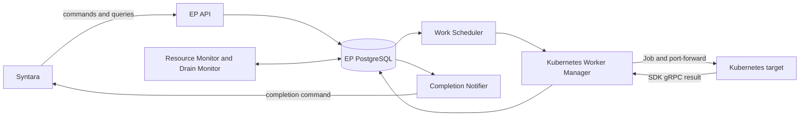

# Execution Plane architecture

The Execution Plane (EP) is a standalone HTTP API and worker service. Syntara
(AO) owns workflow definitions, user authorization, integrations, and Temporal
activities. EP owns accepted work, clusters, execution targets, execution state,
and completion delivery. EP does not connect to AO's database or Temporal.

## Processes and persistence

The `execution-plane-api` process authenticates service clients, applies commands,
and serves client-scoped resource queries. The `execution-plane-worker` process
claims and places work, dispatches workloads, monitors target health, drains
deleted resources, delivers completions, and reconciles orphaned NetworkPolicies.
Both use the EP-owned PostgreSQL database and `execution_plane` schema. Alembic
runs separately with migration credentials. The databases may share a PostgreSQL
server with AO, but the service boundary is HTTP.

## Request to completion

1. AO sends `work.execute` to `POST /v1/commands`. EP validates it and persists
   a pending WorkItem under the caller's command UUID. PostgreSQL NOTIFY wakes
   the worker; polling is a fallback.
2. `WorkScheduler` reserves work, queries `PlacementResolver`, and assigns an
   eligible target after rechecking its current state under database locks.
3. The worker selects the manager registered for the target's backend.
   `VanillaK8sWorkerManager` allocates a single-attempt Job and invokes the SDK
   container service through a Kubernetes API port-forward.
4. EP persists the outcome and completion-notification state before resource
   cleanup. `CompletionNotifier` delivers a command to AO, retrying until it
   receives a correlated receipt. AO owns the bridge to its Temporal activity.

## Code ownership

| Component | Implementation |
| --- | --- |
| HTTP ingress and authentication | [api/](../src/execution_plane/api/) |
| Domain command handlers and resource queries | [commands/](../src/execution_plane/commands/) |
| Cluster registration and persistence | [cluster/](../src/execution_plane/cluster/) |
| Target persistence | [execution_target/](../src/execution_plane/execution_target/) |
| Work persistence and scheduling | [work_item/](../src/execution_plane/work_item/) |
| Eligibility and backend registry | [execution_target_reconciler/](../src/execution_plane/execution_target_reconciler/) |
| Kubernetes execution | [worker_manager/vanilla_k8s/](../src/execution_plane/worker_manager/vanilla_k8s/) |
| Health monitoring | [resource_monitor/](../src/execution_plane/resource_monitor/) |
| Draining | [drain_monitor.py](../src/execution_plane/drain_monitor.py) |
| Outbound completion delivery | [completion_notifier/](../src/execution_plane/completion_notifier/) |

`WorkStore`, `ClusterStore`, and `ExecutionTargetStore` own database sessions,
transactions, and domain transitions. The reconciler is a query over snapshots;
the scheduler owns reservation and assignment. There is no separate WorkWatcher
or pool autoscaler. The worker registers only the Kubernetes manager, even
though the target model also represents deferred backend types.

The separately installable [execution-plane-client](../src/execution_plane_client/README.md)
contains Pydantic command contracts, validation, a catalog, and an in-memory
handler registry. Applications provide HTTP clients, authentication, and handlers.
EP consumes the external SDK container protocol through its
[workload adapter](workload-protocol.md).
